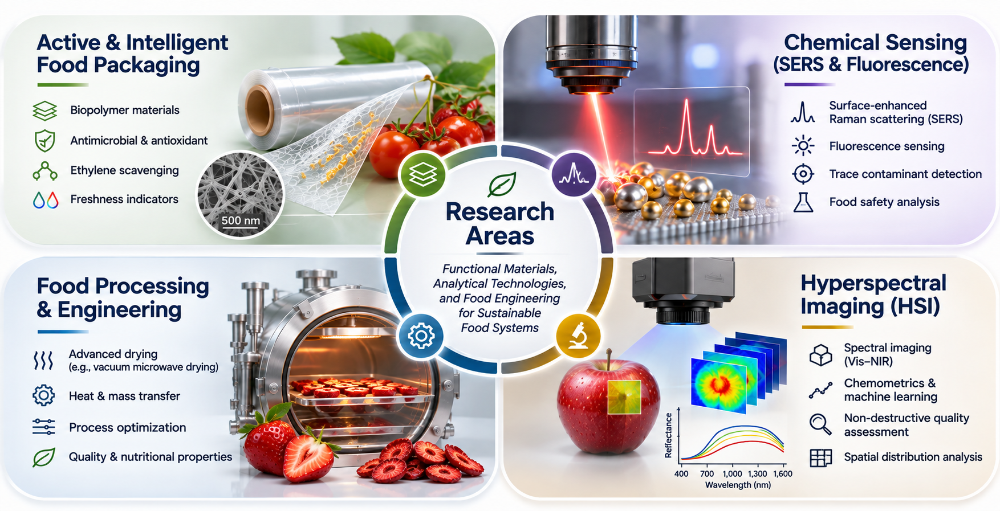
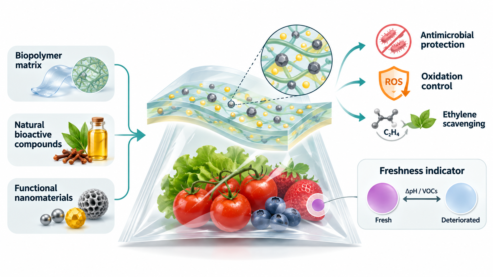
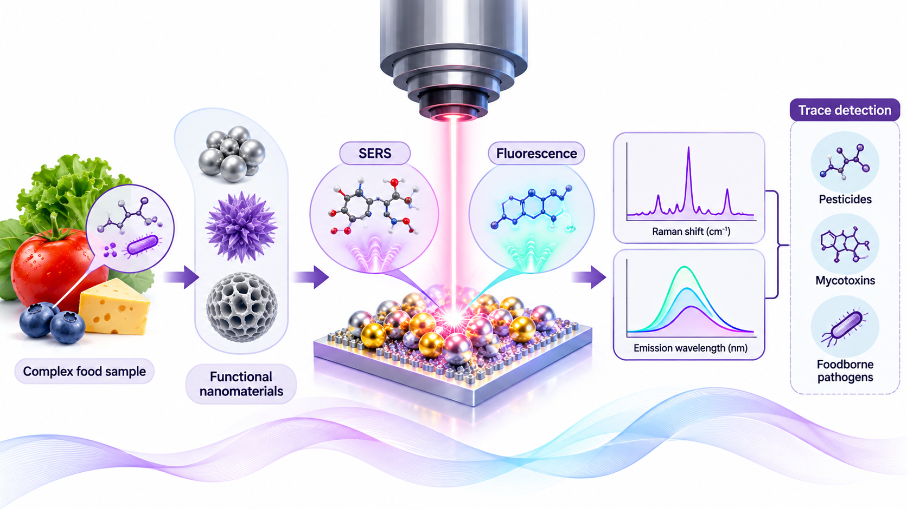
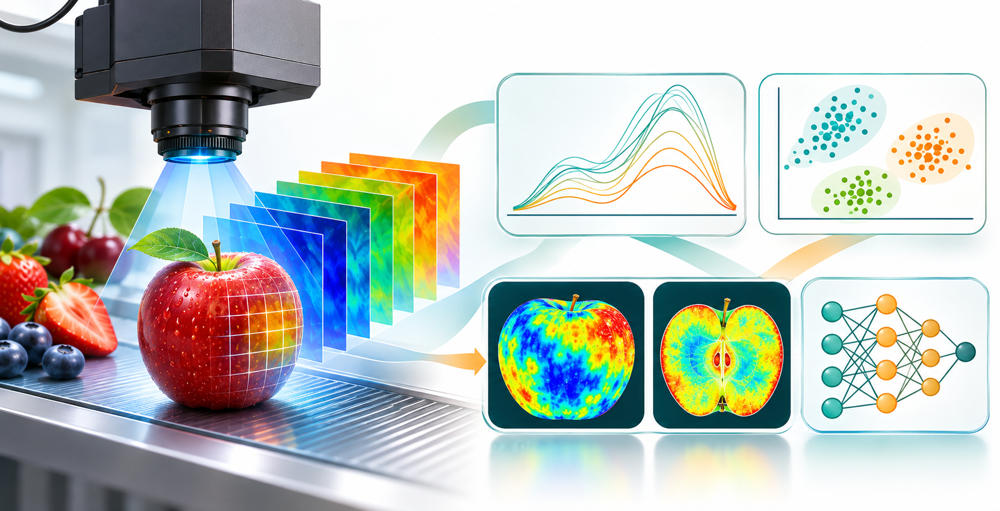
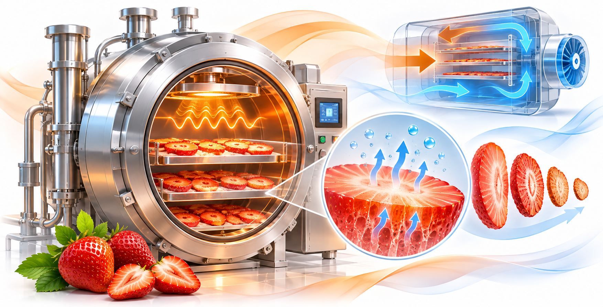

My research integrates food science, materials science, analytical chemistry, and engineering to address challenges in food quality, safety, and sustainability. I am particularly interested in the development of functional packaging materials, chemical sensing platforms, and advanced analytical and processing technologies for sustainable food systems.

---

## 1. Active and Intelligent Food Packaging

Food packaging can do more than simply protect food. Conventional packaging primarily serves as a physical barrier, offering limited control over the biological and chemical processes that drive food deterioration. Active and intelligent packaging systems offer new opportunities to regulate these processes while providing information about product freshness. My research explores the integration of biopolymers, natural bioactive compounds, and functional nanomaterials to develop sustainable packaging systems with enhanced protective, preservative, and sensing capabilities. The broader goal is to maintain food quality, extend shelf life, and reduce postharvest losses.

---

## 2. Chemical Sensing

The detection of chemical contaminants at trace concentrations remains a major challenge in food quality and safety assessment. Conventional analytical methods often require sophisticated instrumentation, extensive sample preparation, and time-consuming procedures, limiting their applicability to rapid and on-site analysis. Optical sensing technologies offer an alternative through the sensitive detection of molecular signatures. My research explores the design of functional nanomaterials and sensing platforms based on surface-enhanced Raman scattering (SERS) and fluorescence spectroscopy, with the goal of improving detection sensitivity, analytical reliability, and practical applicability in complex food systems.

     
---

## 3. Hyperspectral Imaging

Food quality cannot always be adequately described by a single measurement. Conventional analytical methods often rely on destructive sampling and bulk measurements, which overlook spatial variations in the chemical composition and physical properties of food products. Hyperspectral imaging offers a different perspective by integrating spectroscopy and spatial imaging within a single analytical platform. My research combines hyperspectral imaging, chemometrics, and machine learning to quantify food quality attributes, visualize spatial heterogeneity, and develop non-destructive approaches to food characterization and process monitoring.

     
---

## 4. Food Processing and Engineering

The challenge in food processing extends beyond achieving the desired product characteristics to preserving quality while improving processing efficiency. Conventional drying technologies often involve prolonged processing times, substantial energy consumption, and undesirable changes in food structure, nutritional composition, and sensory properties. Advanced drying technologies offer opportunities to overcome these limitations through more effective control of heat and mass transfer. My research examines the relationships between processing conditions, moisture transport, and physicochemical changes, with an emphasis on vacuum microwave drying and the development of efficient and sustainable food processing strategies.

